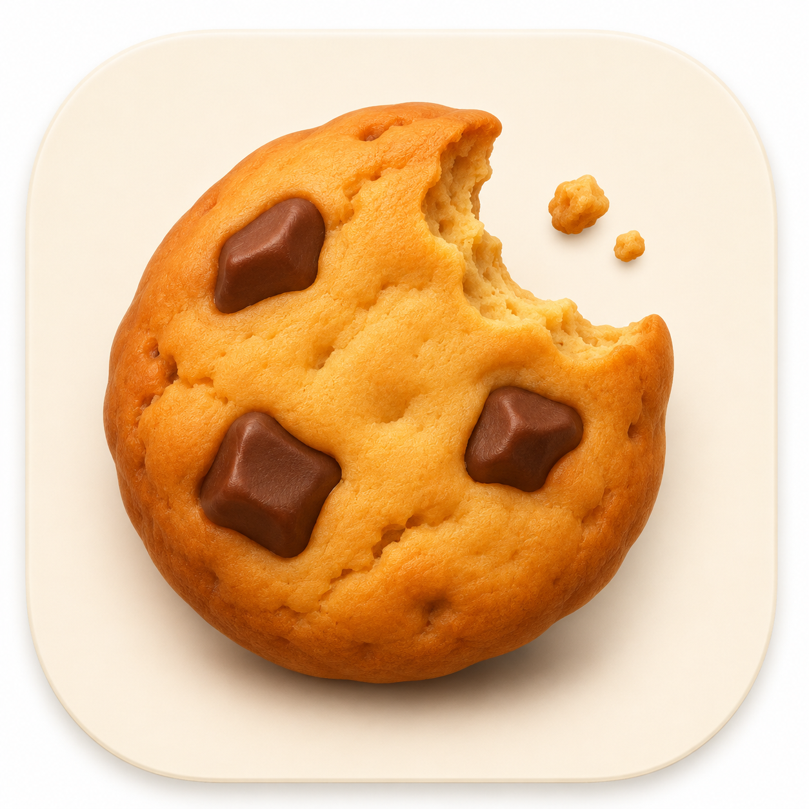

<p align="center"></p>

# Cookie Eater

Fewer banners. More browsing.

Cookie Eater handles cookie consent automatically in Safari on Mac. It rejects optional cookies when possible, works through settings and legitimate-interest choices, and accepts when the only alternative is a paid subscription. Ambiguous choices stay untouched.

Bundled rules handle familiar banners. Apple’s on-device Foundation Models interpret unfamiliar controls in their language. Browsing content and inference stay on your Mac. No account, telemetry, cloud inference, or remote rule service. See the [privacy policy](PRIVACY.md).

## Install

1. Download the Mac app from [GitHub Releases](https://github.com/nbonamy/cookie-eater/releases/latest).
2. Unzip it and move **Cookie Eater.app** to **Applications**.
3. Open Cookie Eater, choose **Open Safari Settings**, and enable the extension.
4. Allow access to the websites you choose, or select **Always Allow on Every Website**.

It runs automatically. You can quit the companion app; Safari runs the extension independently. You do not need to click a button or use a shortcut on each website.

The download is a notarized universal app for Apple silicon and Intel Macs. Requires macOS 14 or later. On-device AI requires macOS 26 or later, a supported Mac, and an available Apple Intelligence model. Bundled rules remain available without AI. This version supports Mac only.

## Your choices

The Safari toolbar popup lets you pause a site, retry, toggle Apple Intelligence, and clear recent activity. The latest 100 outcomes stay locally on your Mac; private-window activity is not saved.

| Outcome | Meaning |
|---|---|
| Verified | Fresh Cookiebot category flags confirm optional cookies are off. |
| Requested | A rejection was submitted, without enough stored evidence to verify it. |
| Accepted | Cookies were accepted to continue when no free rejection path was found. |
| Needs attention | The controls were ambiguous or the interaction could not finish safely. |

Free rejection and settings take priority over acceptance. Cookie Eater avoids subscription, payment, sign-in, external navigation, and ambiguous controls. The model’s decisions are checked against live controls and an independent semantic assessment, with bounded interactions. Banner disappearance alone does not count as verified rejection.

## Build

Use Xcode 26 or later and Node.js 22.12 or later:

```sh
npm ci
./scripts/build.sh
open 'build/Build/Products/Debug/Cookie Eater.app'
```

The default build is ad-hoc signed and requires **Safari → Settings → Developer → Allow unsigned extensions** for local development. To use a development certificate from your own keychain:

```sh
COOKIE_EATER_SIGN_IDENTITY='Apple Development: Your Name (CERTID)' \
COOKIE_EATER_TEAM_ID='TEAMID' COOKIE_EATER_CONFIGURATION=Debug ./scripts/build.sh
```

Signing identities, team IDs, passwords, and provisioning files belong in your local environment or keychain. Distribution builds require Developer ID signing and Apple notarization.

## Test

```sh
npm test
npx playwright install webkit
npm run test:browser
./scripts/test-native.sh
```

The WebKit suite uses controlled fixtures. Native tests exercise the real on-device model when available. To test live websites with the shipped content engine and real Swift model, each in an empty browser profile:

```sh
./scripts/test-live.sh https://www.zdf.de https://www.lidl.de https://www.rai.it https://www.euronics.it
```

This reports clicks, outcomes, remaining controls, and banner persistence after reload with automation paused. It does not replace Safari installation and native-messaging checks. See [validation](VALIDATION.md) for coverage and limits.

For manual Safari fixtures, run `node scripts/fixtures.cjs` and visit <http://127.0.0.1:8765>.

## Feedback

[Report a banner that needs attention](https://github.com/nbonamy/cookie-eater/issues). Include the website, macOS version, banner language, and expected choice. Avoid sharing personal information or cookie values.

## License

[Apache 2.0](LICENSE). Copyright 2026 Nicolas Bonamy.
